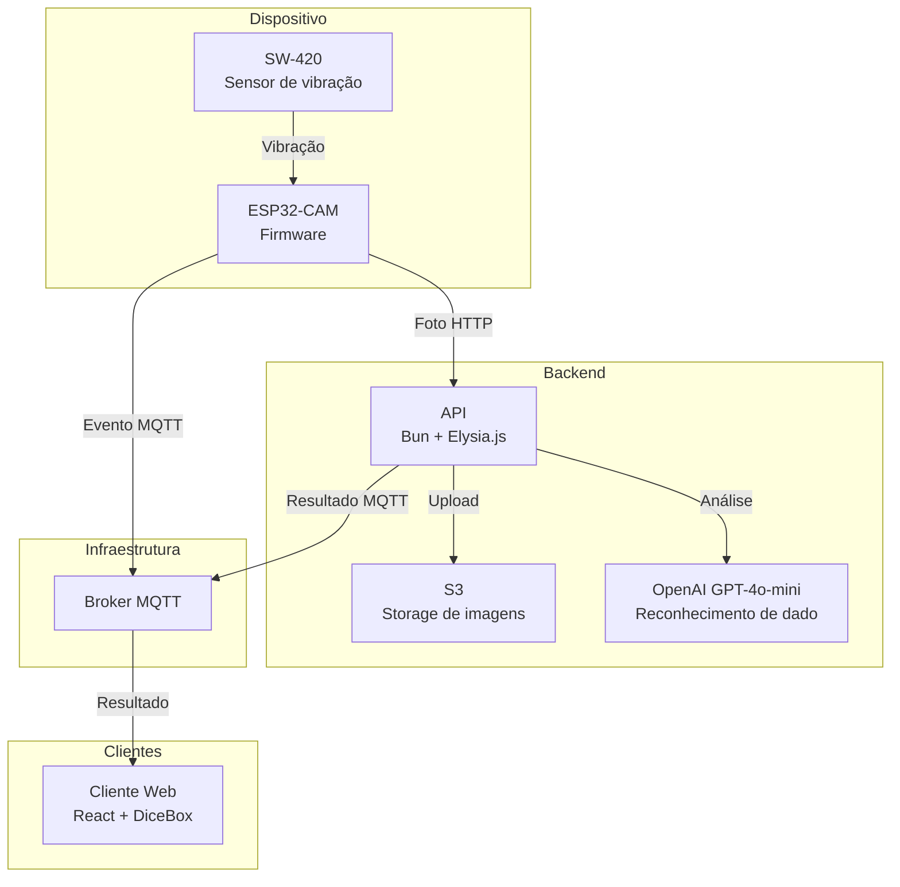
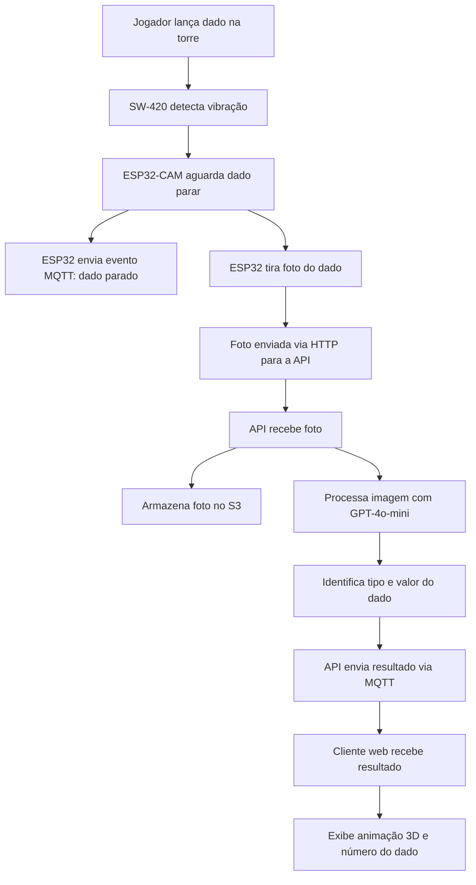
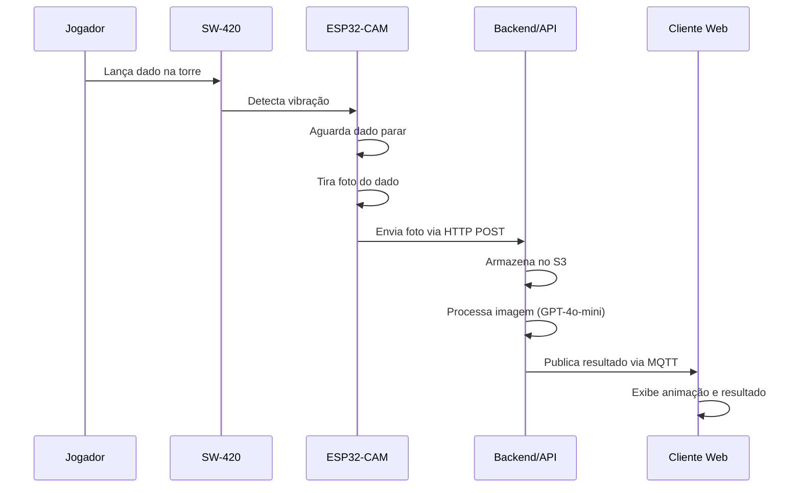
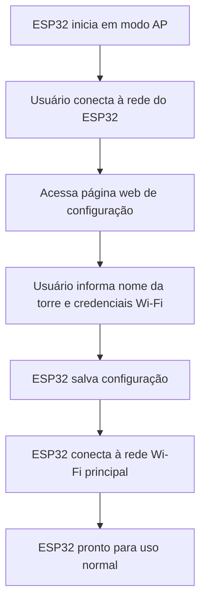

# Arquitetura do NeverDice — v1

## Visão geral

NeverDice é um sistema composto por quatro camadas principais: dispositivo embarcado (ESP32-CAM), API backend, broker MQTT e cliente web/mobile. A comunicação entre elas é feita via HTTP (upload de foto) e MQTT (eventos e resultados em tempo real).

## Componentes e responsabilidades

### ESP32-CAM (firmware)

- Monitora vibração via sensor SW-420.
- Detecta quando o dado para de se mover.
- Captura foto do resultado do dado.
- Envia foto via HTTP multipart para a API backend.
- Publica eventos via MQTT (ex.: "dado parado").
- Recebe comandos via MQTT (ex.: capture-photo, stream, configuração de LED).
- Configuração inicial via modo AP — o usuário conecta-se à rede do ESP32 e informa credenciais Wi-Fi pelo navegador.

**Tópicos MQTT do dispositivo:**

| Tópico | Direção | Descrição |
|--------|---------|-----------|
| `devices/{id}/config/#` | Subscribe | Configuração remota (webhook, wi-fi, LED) |
| `devices/{id}/commands/#` | Subscribe | Comandos (capture-photo, stream) |
| `devices/{id}/logs` | Publish | Logs do dispositivo |

### API Backend (Bun + Elysia.js + TypeScript)

- Recebe foto multipart do ESP32-CAM no endpoint de processamento.
- Armazena imagem no S3 (upload temporário com presigned URL).
- Processa a imagem com modelo de visão (OpenAI GPT-4o-mini) para identificar o resultado do dado.
- Retorna JSON com tipo do dado e valor (`{"type": "dX", "value": N}`).
- Publica resultados via broker MQTT para os clientes.

**Tópicos MQTT da API:**

| Tópico | Direção | Descrição |
|--------|---------|-----------|
| `dice/roll` | Publish | Resultado da rolagem para os clientes |
| `logs/{clientId}` | Publish | Logs da API |

### Cliente Web (React + TypeScript)

- Conecta-se ao broker MQTT via WebSocket (WSS).
- Assina o tópico `dice/roll` para receber resultados em tempo real.
- Exibe animação 3D do dado rolando (DiceBox).
- Mantém histórico de rolagens (máximo 50).
- Estatísticas: total, média e último resultado.

### Broker MQTT

- Transporta mensagens entre ESP32, API e cliente web.
- Configuração atual usa broker externo (Astrum) com fallback para brokers públicos (Mosquitto, EMQX, HiveMQ).
- Autenticação por username/password.

## Diagrama de componentes

## Diagrama de fluxo principal

## Diagrama de sequência

## Diagrama de onboarding

## Fronteiras de confiança (Trust Boundaries)

| ID | Fronteira | Dados que atravessam | Validações necessárias |
|----|-----------|---------------------|----------------------|
| F-01 | Navegador → AP do ESP32 | Nome da torre e credenciais Wi-Fi | Janela de configuração limitada; não expor senha em log; validar tamanho |
| F-02 | ESP32-CAM → API | Foto (multipart) e métricas (pulses, rollTime, entropy, dice) | Autenticação do dispositivo; limite de tamanho; tipo de conteúdo; timeout |
| F-03 | ESP32-CAM ↔ Broker MQTT | Eventos e comandos | Autenticação individual; ACL por dispositivo; tópicos mínimos |
| F-04 | API → S3 | Foto armazenada | Bucket privado; permissão mínima; URL com expiração; retenção definida |
| F-05 | API → Cliente Web | Resultado da rolagem | Autenticação/autorização se o resultado não for público |
| F-06 | Código/CI → Ambiente | Configurações e segredos | Segredos fora do Git; logs de pipeline sem valores; revisão |

## Stack tecnológica

| Camada | Tecnologia |
|--------|-----------|
| Firmware | ESP32-CAM, Arduino, PlatformIO, PubSubClient, SW-420 |
| Backend | Bun, Elysia.js, TypeScript, OpenAI API, S3Client |
| Frontend | React, TypeScript, Vite, MQTT.js, DiceBox (3D) |
| Comunicação | MQTT (WSS), HTTP/HTTPS (multipart) |
| Storage | S3 (compatível) |
| Processamento de imagem | OpenAI GPT-4o-mini (visão) |
